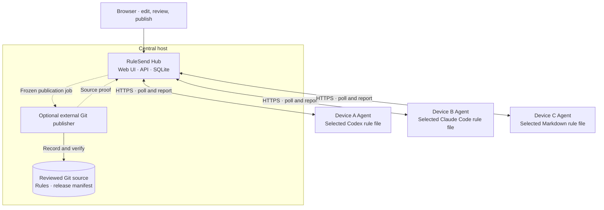

# RuleSend

**Your AI rules. Every device.**

RuleSend is an open-source, self-hosted Hub and Agent for managing shared Markdown instructions for Codex, Claude Code, and other tools that read Markdown rule files. Edit rules in one place, publish a version, and see what arrived on each device.

**First prototype — work in progress.** The alpha supports macOS and Linux. Windows Hub and Agent runtime support is not available yet.

## Why use RuleSend?

- Keep shared preferences and working conventions consistent across devices.
- Review changes before publishing; saving a draft does not deploy it.
- See each device's last contact, installed version, content hash, and reported conflicts or errors.
- Preserve existing configuration outside RuleSend's managed section, with local backups before replacement.
- Ask your own AI for a proposal, compare the changes, and approve them without connecting RuleSend to an AI provider.

A **rule pack** is one UTF-8 Markdown document. Each locally selected target file can contain one RuleSend pack. Application-specific and project rules can remain outside its managed block.

## Architecture

One Go executable provides both Hub and Agent commands. The Hub includes the browser UI and stores its state in SQLite. Each device runs its own Agent and chooses its target files locally.



1. **Edit and publish:** save a draft, then explicitly publish an immutable version.
2. **Optional Git recording:** for a source-backed pack, publication queues the exact saved text. A separately reviewed publisher records and verifies it in Git before the Hub makes it available to Agents. Ordinary packs publish directly. RuleSend supplies the job API; it does not bundle a Git publisher or run browser-supplied commands.
3. **Receive:** Agents initiate connections to the Hub. They poll approximately every 15 seconds and apply according to each pack's automatic interval or manual sync request. Paused packs remain paused.
4. **Apply safely:** the Agent checks the published hash and its local baseline, backs up the existing file, replaces only its managed block, and reads the result back. Local edits to that block cause a conflict instead of being silently overwritten.
5. **Report:** the Agent sends the installed version, hash, and outcome to the Hub. File installation, fresh-session rule loading, and actual AI behavior are separate checks.

Git source version labels and Hub publication numbers are independent. Restoring an old release creates a draft; publishing it produces a new version rather than rewriting history.

## Install

Build from a checkout of this repository with **Go 1.25 or newer**:

```sh
mkdir -p dist
go build -trimpath -o dist/rulesend ./cmd/rulesend
./dist/rulesend --help
```

Run the following commands from that checkout, or install the built executable in a location you control and use its absolute path. Build on each device for its operating system and architecture. The embedded UI needs no separate frontend build.

### 1. Start a Hub

Choose one host for the Hub. Keep its private data outside your source checkout and synced folders:

```sh
./dist/rulesend hub init --data "$HOME/.local/share/rulesend/hub"
./dist/rulesend hub serve \
  --data "$HOME/.local/share/rulesend/hub" \
  --listen 127.0.0.1:8787
```

Open `http://127.0.0.1:8787` on that host. Initialization prints the location of the private `admin-token` file. Copy its contents locally into the browser's **Administrator token** field; never paste it into an AI conversation or issue. The server stays in the foreground until you press Ctrl+C, and restarting with the same data directory preserves its state.

This loopback setup is for a local trial. For other devices, configure a valid **HTTPS** address using direct TLS or a trusted same-host reverse proxy. Keep a proxied backend on loopback and set `--public-url` to the exact HTTPS origin. See [network setup and operations](docs/OPERATIONS.md#https-and-network-access). Use that HTTPS address in each remote Agent's `--hub` option; do not disable certificate verification.

### 2. Create a pack and enroll a device

In the Hub:

1. Open **Rule packs**, choose **New rule pack**, and create your Markdown draft.
2. Save edits and choose **Publish version**. Review the scope before confirming. A pack may be published before its first device is enrolled.
3. Choose **Add device**, select the packs it may receive, and create a short-lived, single-use enrollment token.
4. Save that token to a private file on the receiving device with owner-only permissions. Copy the pack ID from the Hub's **Agent setup guide**.

On that device, replace `PACK_ID` and the token-file path below. The loopback URL works only when the Agent and Hub are on the same host:

```sh
./dist/rulesend agent enroll \
  --data "$HOME/.local/share/rulesend/agent" \
  --hub http://127.0.0.1:8787 \
  --name "My laptop" \
  --token-file /absolute/private/enrollment-token
```

Enrollment stores a device credential privately. It does not grant a local file path or modify your AI rules. Remove the temporary enrollment-token file after successful enrollment.

### 3. Select a target, preview, and apply

Install your AI tool first and review its existing rules and any other rule-delivery tools. The target's parent directory must already exist. For a conventional Codex installation:

```sh
./dist/rulesend agent bind \
  --data "$HOME/.local/share/rulesend/agent" \
  --pack PACK_ID --adapter codex --default --label "Codex rules"

./dist/rulesend agent preview --data "$HOME/.local/share/rulesend/agent"
./dist/rulesend agent once --data "$HOME/.local/share/rulesend/agent"
./dist/rulesend agent status --data "$HOME/.local/share/rulesend/agent"
```

Read the preview before running `once`. Binding alone does not write the target file. `--default` explicitly selects `~/.codex/AGENTS.md` for `codex` or `~/.claude/CLAUDE.md` for `claude`. To add Claude Code, bind the chosen pack with `--adapter claude --default` before starting the Agent. For a project/custom file or a customized app configuration directory, use an explicit absolute `--path` instead of `--default`. Use `--adapter markdown` for other Markdown targets.

An existing RuleSend block needs its original Agent state; do not delete that state or re-enroll to work around a conflict. Review other writers before allowing two tools to manage the same rules. Codex targets have a 32 KiB whole-file limit; Claude Code and Markdown targets have a 128 KiB limit.

### 4. Keep the Agent running

```sh
./dist/rulesend agent run --data "$HOME/.local/share/rulesend/agent"
```

This runs in the foreground until Ctrl+C. After verifying a manual installation, use the [macOS or Linux user-service examples](docs/OPERATIONS.md#start-automatically) for startup and restart behavior. Repeat enrollment and binding on each additional device.

Stop an Agent using the same data directory before `enroll`, `bind`, `preview`, or `once`. `status` can run while the Agent is active, but shows saved observations rather than a fresh file inspection.

## Use

### Edit and deploy

Open **Rule packs**, select a pack, edit its Markdown, and choose **Save draft**. Choose **Publish version**, review the receiving scope, and confirm. Automatic packs apply on their configured interval; manual packs wait for **Sync now** or a local `agent once`. **Sync now** does not resume a paused pack.

Check the Hub's device coverage for the version, hash, and reported outcome. If a device is offline, it checks the current published version when it reconnects. Resolve conflicts locally while preserving your edits and backups. Start a fresh AI session and check rule loading separately; existing chats are not automatically refreshed, and an `applied` receipt does not prove AI compliance.

### Write rules with your own AI

1. Choose **Ask my AI**, describe the behavior you want, and select **Generate prompt**.
2. Review and **Copy prompt**, then paste it into an AI allowed to receive those rules. The prompt contains the selected draft and request, not Hub credentials or other packs.
3. Bring the complete JSON response back through **Import proposal** and **Review changes**.
4. Compare the full before/after text and diff, then select the review checkbox and **Approve to draft**.
5. Choose **Save draft**, then **Publish version**. Approval alone does not save or deploy anything.

The proposal must match the pack, draft revision, and exact content hash. If the baseline changed, generate a new prompt. See [AI-assisted authoring](docs/AI_AUTHORING.md) for the response format and review details.

### Short prompts

**Installation assistance:** replace the placeholders and paste this into your coding assistant. Supply credentials through private local input, not the prompt.

```text
Help me set up RuleSend using this repository and its README.
Role: <Hub, Agent, or both>. AI tool: <Codex or Claude Code>.
Existing Hub URL, if connecting an Agent: <HTTPS URL>.
Inspect existing rules and delivery tools; preserve unrelated settings.
Show the selected target and preview before applying. Use private token files
or local input, never expose secrets, and use HTTPS between devices.
Verify file installation and fresh-session loading separately. Report what
was actually checked. Ask before changing existing writers or enabling startup.
```

**Rule-editing request:** paste this into **What should your AI do differently?** under **Ask my AI**, then copy the complete generated prompt to your AI.

```text
Make my AI <desired behavior> when <specific situation>.
Keep the change small and testable. Preserve company/project policy,
privacy protections, approval boundaries, and unrelated preferences.
Explain any conflict or removed protection and suggest a way to check it.
Return a proposal only; I will review, save, and publish it in RuleSend.
```

## Security and current limits

Administrator, publisher, and device credentials have separate roles. Enrollment is scoped and single-use, and target paths are approved locally. Hub requests cannot assign arbitrary file paths or shell commands. Keep credentials, databases, Agent state, and backups private and outside Git or synchronized folders.

This alpha has one administrator and no built-in administrator-token rotation, automatic AI behavior verification, Windows runtime, or automatic repair/force command. Revoking a device blocks future requests but leaves its installed files in place. Backups and audit history need operator-managed retention. See [security](SECURITY.md) and the [threat model](docs/THREAT_MODEL.md).

## Documentation

- [CLI reference](docs/CLI.md)
- [Operations, services, backups, and recovery](docs/OPERATIONS.md)
- [AI-assisted rule editing](docs/AI_AUTHORING.md)
- [Implementation contract](docs/IMPLEMENTATION_CONTRACT.md)
- [Validation and known limits](docs/VALIDATION.md)
- [Contributing](CONTRIBUTING.md)

## License

MIT. See [LICENSE](LICENSE) and [third-party notices](THIRD_PARTY_NOTICES.md).
